<picture><source media="(prefers-color-scheme: dark)" srcset="https://wickrunai.com/brand/logo-dark.svg"></picture>

# wickrunAI · 灯芯AI

**One workspace to orchestrate all your AI.**

[Download](https://wickrunai.com/download) · [All releases](https://github.com/lifishard/wickrunAI-releases/releases) · [Report a problem](https://github.com/lifishard/wickrunAI-releases/issues)

**English** · [简体中文](README.zh-CN.md)

<picture><source media="(prefers-color-scheme: dark)" srcset="assets/demo.en.dark.svg"></picture>

Illustration, not a screen recording.

## What it is

wickrunAI puts all the AI you use into one app, on Windows, macOS, Linux, the web and Android. You connect your own model accounts and the AI apps you already use, such as Claude Code and Codex, and work with all of them in one place. Your accounts, subscriptions and bills stay with each provider.

## What it does for you

**Your AI is spread over several apps and subscriptions, and your conversations and files end up scattered.** Connect them all here: the key a model provider gives you, the AI apps signed in on your computer (Claude Code, Codex, Kimi Code, Grok), and local models from Ollama or LM Studio. Conversations, files and projects stay in one place.

**A model hits its usage limit or stalls halfway, and you have to explain everything again somewhere else.** List two or more of your accounts in the order you want. When one runs out of quota or keeps getting refused, the task moves to the next one and continues from where it stopped. You set the order once, and only accounts you connected are used. This applies to model accounts connected with a key; the AI apps signed in on your computer, such as Claude Code, do not take part in the automatic takeover. If you pause and pick another model yourself, it also picks up from the saved point.

**You want a second opinion from another model, so you copy and paste between windows.** Bring several models into the same conversation, or have one model check another's work, without copying anything.

**Teammates share AI results as screenshots, and nobody can pick up the actual conversation.** Share the conversation itself. Teammates can read it, comment, or carry on with their own AI accounts. Every message and every change to a file shows who made it and with which model, and people and models can edit the same file at the same time.

**You do not want to hand your keys or your conversations to yet another service.** Your keys are kept in your computer's protected storage and stay on that device unless you turn on key sync. Cloud sync is your choice. What you sync or share is end-to-end encrypted, so our server cannot read it, and sharing never passes on your keys.

## Your first answer in a minute

1. **Download.** Get wickrunAI from [wickrunai.com/download](https://wickrunai.com/download) and install it. No account, no sign-up.
2. **Add one key.** Open Settings → API credentials, paste the address and key from your model provider, and press **Test connection**. To start for free, pick the OpenRouter preset.
3. **Ask something.** Choose a model next to the message box and send.

Later you can add a second account to take over when the first runs out, give the AI a folder to work in, or connect the AI apps on your computer from the model picker.

## Download

<!-- releases-readme:installer -->

Official installers for wickrunAI. In-app updates and [wickrunai.com/download](https://wickrunai.com/download) read from this repository. **[Download the latest version →](https://github.com/lifishard/wickrunAI-releases/releases/latest)**

| System | Which file |
| --- | --- |
| Windows | `…-win-x64-setup.exe` (installer, updates automatically); no install: `…-win-x64-portable.exe` |
| macOS | Apple silicon: `…-mac-arm64.dmg`; Intel: `…-mac-x64.dmg` |
| Linux | `…-linux-x64.AppImage` (updates automatically) or `…-linux-x64.deb` |
| Android | `…-android-preview.apk` (preview; before upgrading from 3.x, read the backup note in the release notes) |

The `.yml` and `.blockmap` files are for automatic updates. Installers are not code-signed yet, so Windows and macOS warn about an unknown publisher; download only from here or wickrunai.com.

<!-- /releases-readme:installer -->

## Three generations

### 4.0 · Work with other people

Share files, folders, conversations and projects with people on other accounts, and choose who can view, comment or edit. Teammates join the same conversation, and every AI reply shows whose account and which model wrote it.

### 5.0 · One set of files for the whole team

Shared folders and projects can keep one copy of each file in the cloud, with its full history, so everyone sees the same version on the web, desktop and phone. When two people edit at once, nobody's work is overwritten, and you can hand a task to the AI on your own or a teammate's computer and review the result.

[5.0.0 release notes](https://github.com/lifishard/wickrunAI-releases/releases/tag/v5.0.0)

### 6.0 · People and AI edit the same file live

Several people and their AI can work in one file at the same time. Changes appear on everyone's screen right away, each one marked with who or which model made it, and any earlier version can be restored.

[6.0.0 release notes](https://github.com/lifishard/wickrunAI-releases/releases/tag/v6.0.0)

[All release notes](https://github.com/lifishard/wickrunAI-releases/releases)

## Permissions and data

Tool permissions are set per conversation, and file tools only reach the working directories you name. Command-line and browser tools act on your computer or on websites, so check the task and the target before you authorize them.

On desktop, API keys go into the operating system's encrypted storage where it is available. Configuration, conversations, and task material stay on your machine; when you call a model or a tool, the relevant content goes to the service you configured.

## Disclaimer

wickrunAI is an independent service and is not affiliated with, endorsed by, or owned by Anthropic, OpenAI, Google, xAI, SenseTime, Moonshot AI, OpenRouter, or any other model provider or service named in this repository. Product names, logos and trademarks are the property of their respective owners and are used here only to describe what this client can connect to.

Connecting to a provider requires your own account and credentials with that provider, and your use of their service is governed by their terms, not by this project's. Accounts, subscriptions, quotas and charges stay with the provider. wickrunAI does not resell access to any of them. The web version relays your requests to the provider you chose, with your own key, and does not store them.

---

<!-- releases-readme:footer -->

## Feedback

Report problems in [Issues](https://github.com/lifishard/wickrunAI-releases/issues); report security issues privately to admin@wickrunai.com.

## License

wickrunAI 4.1.1 and later are proprietary software, free to use under the [wickrunAI Software License](LICENSE). This repository contains installers only, not source code. Versions 4.1.0 and earlier were released under the Apache License 2.0. Open-source components keep their own licenses, listed in `THIRD_PARTY_LICENSES.txt` inside the app.

<!-- /releases-readme:footer -->
