<picture><source media="(prefers-color-scheme: dark)" srcset="https://wickrunai.com/brand/logo-dark.svg"></picture>

# wickrunAI · 灯芯AI

**一个工作空间，调度你所有的 AI**

[下载](https://wickrunai.com/download) · [全部版本](https://github.com/lifishard/wickrunAI-releases/releases) · [反馈问题](https://github.com/lifishard/wickrunAI-releases/issues)

[English](README.md) · **简体中文**

<picture><source media="(prefers-color-scheme: dark)" srcset="assets/demo.zh-CN.dark.svg"></picture>

示意动画，非实际录屏

## 这是什么

灯芯AI 把你用的 AI 放进同一个应用，支持 Windows、macOS、Linux、网页和 Android。你接入自己的模型账号，以及已经在用的 AI 应用，比如 Claude Code 和 Codex，在同一处使用它们。账号、订阅和费用仍由各服务商管理。

## 它帮你解决什么

订阅买了一堆，活还是要开五个窗口来回粘贴？wickrunAI 把它们收进一处：

- **所有模型，一个入口**：自带 Key，对话、改文件、群聊、看板、管家，都在同一处发生
- **一段对话，大家接着做**：多个模型、多个人在同一个对话里，各用各的 AI，每一步都有记录
- **限速不断活**：排好接力名单，一个账号撞上限速，下一个自动接上
- **任务收尾不中断**：中途不丢现场，交付前逐项核对，拒绝“看起来做完了”

## 一分钟拿到第一个回答

1. **下载。** 在 [wickrunai.com/download](https://wickrunai.com/download) 下载并安装，不用注册，不用登录。
2. **填一个 Key。** 打开 设置 → API 凭据，填入模型服务商给你的地址和 Key，点「测试连接」。想先免费用，就选 OpenRouter 预设。
3. **问一个问题。** 在输入框旁边选一个模型，发送。

之后可以再加一个账号，在第一个用完时接手；也可以给 AI 一个可以读写的文件夹，或在模型选择器里连接电脑上的 AI 应用。

## 下载安装

<!-- releases-readme:installer -->

这里发布 wickrunAI 的官方安装包。应用内的自动更新和 [wickrunai.com/download](https://wickrunai.com/download) 都从这里获取文件。

**[下载最新版本 →](https://github.com/lifishard/wickrunAI-releases/releases/latest)**

| 系统 | 选哪个文件 |
| --- | --- |
| Windows | `…-win-x64-setup.exe`（安装版，可自动更新）；免安装用 `…-win-x64-portable.exe` |
| macOS | Apple 芯片选 `…-mac-arm64.dmg`，Intel 选 `…-mac-x64.dmg` |
| Linux | `…-linux-x64.AppImage`（可自动更新）或 `…-linux-x64.deb` |
| Android | `…-android-preview.apk`（预览版；从 3.x 升级前请先看版本说明里的备份提醒） |

每个版本的说明写在对应的 Release 页面上。以 `.yml` 和 `.blockmap` 结尾的文件供自动更新使用，不需要手动下载。

安装包目前没有代码签名：Windows SmartScreen 和 macOS Gatekeeper 会提示“未知发布者”，这是预期行为。只从本页或 wickrunai.com 下载。

<!-- /releases-readme:installer -->

## 三次代际升级

### 4.0 · 和别人一起用

可以把文件、文件夹、对话和项目共享给其他账号的人，并决定谁能查看、评论或编辑。同事可以加入同一个对话，每条 AI 回复都标明来自谁的账号、用的哪个模型。

### 5.0 · 团队共用一份文件

共享文件夹和项目可以在云端只保留一份文件和它的完整历史，网页、桌面和手机上看到的都是同一个版本。两人同时修改也不会覆盖对方的成果；还可以把任务交给你或同事电脑上的 AI，做完由人审阅。

[5.0.0 版本说明](https://github.com/lifishard/wickrunAI-releases/releases/tag/v5.0.0)

### 6.0 · 人和 AI 实时改同一个文件

几个人和各自的 AI 可以同时编辑同一个文件。改动立刻出现在每个人的屏幕上，每处都标明是谁或哪个模型改的，任何旧版本都能恢复。

[6.0.0 版本说明](https://github.com/lifishard/wickrunAI-releases/releases/tag/v6.0.0)

[全部版本说明](https://github.com/lifishard/wickrunAI-releases/releases)

## 权限与数据

你可以按会话设置工具权限，并指定允许读写的工作目录。命令行和浏览器工具会对电脑或网站执行操作，授权前请核对任务和目标。

桌面端会在系统支持时使用操作系统的加密存储保护 API Key。配置、会话和任务资料保存在本机；调用模型或工具时，相关内容会发送到你配置的服务。

## 声明

wickrunAI 是独立服务，与 Anthropic、OpenAI、Google、xAI、商汤、月之暗面、OpenRouter 及本仓库中提及的任何其他模型供应商或服务均无关联，未获其认可，亦不为其所有（wickrunAI is an independent service and is not affiliated with, endorsed by, or owned by any of them）。相关产品名称、标识与商标归各自所有者所有，此处仅用于说明本客户端可以连接哪些服务。

连接任一供应商都需要你自己在该供应商处的账号与凭据，你对其服务的使用受该供应商的条款约束，而非本项目的条款。账号、订阅、额度与费用均由供应商管理。wickrunAI 不转售任何一家的访问权限。网页版会用你自己的密钥把请求转发给你选的服务商，不保存请求内容。

---

<!-- releases-readme:footer -->

## 反馈

问题和建议请提交到 [Issues](https://github.com/lifishard/wickrunAI-releases/issues)，写明应用版本、系统和复现步骤，附日志前请删除 API 密钥和私人内容。安全问题请发邮件到 admin@wickrunai.com，不要公开贴出细节。

## 许可

wickrunAI 4.1.1 及以后的版本为专有软件，按 [wickrunAI 软件许可](LICENSE) 免费使用；本仓库只提供安装包，不包含源代码。4.1.0 及更早版本以 Apache License 2.0 发布。应用中使用的开源组件按各自许可证授权，清单随应用提供（`THIRD_PARTY_LICENSES.txt`）。

<!-- /releases-readme:footer -->
